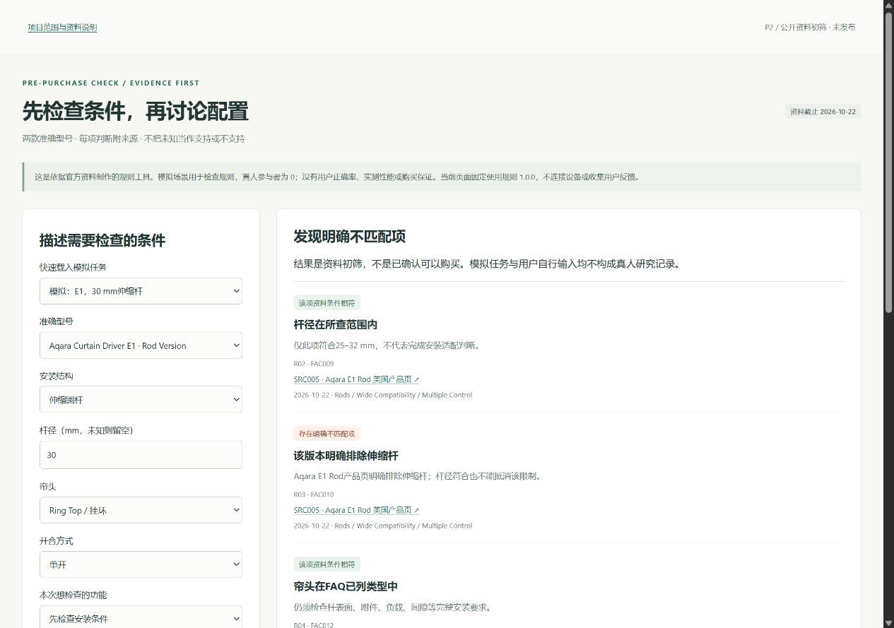

# 智能窗帘购买障碍与配置初筛器

**Smart Curtain Purchase Readiness Checker**

以官方资料为依据，将智能窗帘买前的安装条件与生态设备要求拆成可追溯检查项。面向SwitchBot Curtain 3 Rod Type 1与Aqara Curtain Driver E1 Rod Version的美国市场资料，分别呈现条件相符、明确不匹配、配置缺项和待核信息。

An evidence-linked, local-first checker for selected installation and ecosystem requirements of two smart curtain models. It distinguishes documented matches, explicit mismatches, missing components and unresolved conditions. It is a portfolio prototype, not a complete compatibility certification or purchasing recommendation.

## 当前范围 / Scope

已实现：静态表单、3个预置任务、确定性规则、官方来源链、输入变化后旧结果失效和中英文说明。原计划的用户反馈研究、海外用户洞察、定价/渠道/上市策略未完成，仅列为后续扩展。真人参与者0、实机验证0，未测量转化、退货或销售影响。

Implemented: a static form, three preset tasks, deterministic rules, source links, stale-result invalidation and explanatory copy. User-feedback research and a complete overseas GTM strategy are future work. There are no participant, device-test or commercial-impact results.

## 启动 / Run

在仓库根目录打开终端（Python 3）：

```powershell
python -m http.server 8765 --bind 127.0.0.1 --directory docs
```

浏览器打开 http://127.0.0.1:8765/ 。不需要npm安装、API key或后台。关闭时按Ctrl+C。程序资源本地加载，外部证据链接需要网络。直接file入口和断网浏览器验收范围见验收记录。

## 三个场景 / Representative cases

| 预置任务 | 输入重点 | 预期判断 |
|---|---|---|
| E1，30mm伸缩杆 | 伸缩圆杆、30mm、挂环、单开 | R02尺寸相符，R03结构不符；整体显示明确不匹配 |
| Curtain 3，Apple Home，缺控制器 | 固定28mm、对开、已有品牌Hub、无平台控制器 | R06桥接仍待核，R07提示平台控制器缺项 |
| E1，“已有Hub”能否接Matter | 固定30mm、自报两类设备都有 | R08完整现行路径仍待核 |

页面上方选择预置任务，再点击“检查条件与依据”。[功能与界面](portfolio/FEATURES.md) · [五分钟演示](portfolio/DEMO_SCRIPT.md) · [一页案例](portfolio/CASE_STUDY_ZH.md)

## 证据与限制 / Evidence and limitations

规则1.0.0，原资料快照2026-10-22；来源补充核验记录为2026-10-23及2026-10-24。[来源审计](verification/SOURCE_AUDIT.md)说明逐项依据和历史限制。R11始终提示完整安装尚未核实，未建模重量、摩擦、附件、间隙和校准。不能由一项尺寸符合推断整体可购买；未覆盖轨道不代表硬件不支持轨道。

Vendor documentation is not a hardware test. Historical Matter announcements do not establish every current hub, firmware and regional combination. Unresolved conditions remain unresolved. See [data and licensing scope](DATA_USE.md).

## 验证 / Verification

```powershell
node --test tests/configuration.test.cjs tests/configuration-ui.test.cjs
```

使用Node.js内置测试，无第三方依赖。22项规则测试与8项UI事件适配器测试；适配器不模拟真实浏览器布局或原生输入验证。[本轮验收记录](verification/ACCEPTANCE.md)分别列出新执行的软件、浏览器和发布检查。截图仅取自真实运行页面。

## AI协作与个人贡献 / Contribution boundary

AI辅助整理资料、实现代码、运行软件与浏览器检查及起草说明。项目发起者参与需求提出、业务规则理解及资料核对，并授权AI辅助实施；不据此声称逐项独立实现或主持真人研究。不能据代码文件推断独立编写全部程序，不能将工具运行计作真人研究。

AI assisted with research organization, implementation, testing and documentation. The project owner contributed to requirements, understanding the business rules and checking source materials. No independent authorship of every implementation detail or completed user study is implied.

## 发布与许可 / Publication and license

公开代码仓库：[smart-curtain-purchase-checker](https://github.com/1463332164-ship-it/smart-curtain-purchase-checker)。GitHub Pages部署目标为main分支的/docs；公开演示地址在部署成功后补充。见[发布清单](RELEASE_FILES.md)。

自有可许可代码及原创说明采用[MIT](LICENSE)；第三方材料和商标保留原权利，范围见[DATA_USE](DATA_USE.md)。项目所有者已于2026-10-24授权此候选清单的公开发布与Pages部署；执行状态以验收记录为准。没有自动部署或远程推送脚本。

## 本地验收截图 / Local acceptance screenshots



[手机截图](docs/images/mobile.png) · [可复制中英文简介](portfolio/PROJECT_DESCRIPTION.md) · [面试问答](verification/INTERVIEW_GUIDE.md) · [开放事项](verification/OPEN_ISSUES.md)
